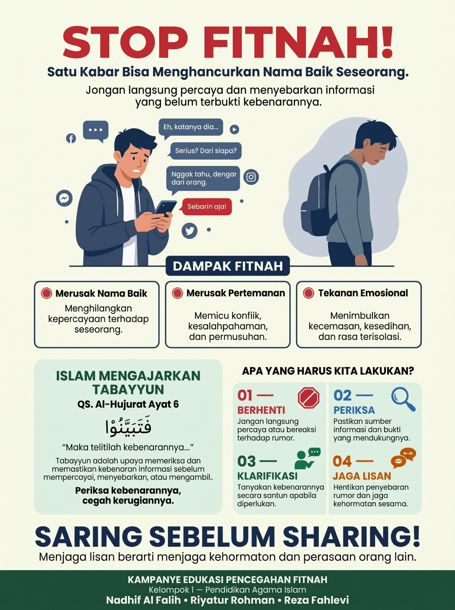
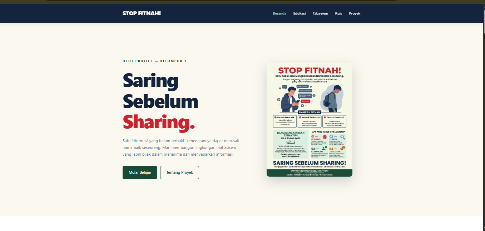
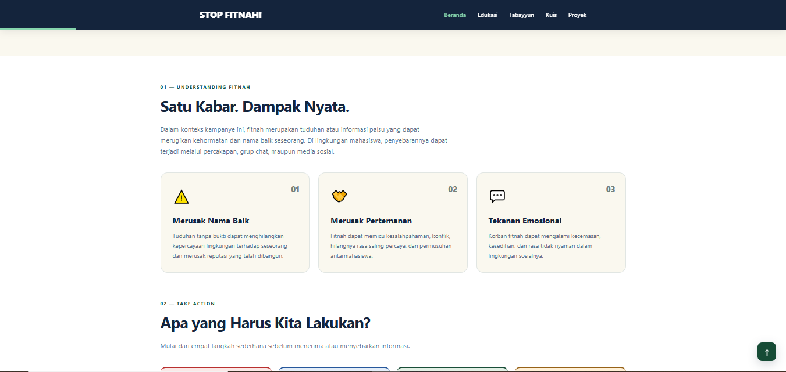
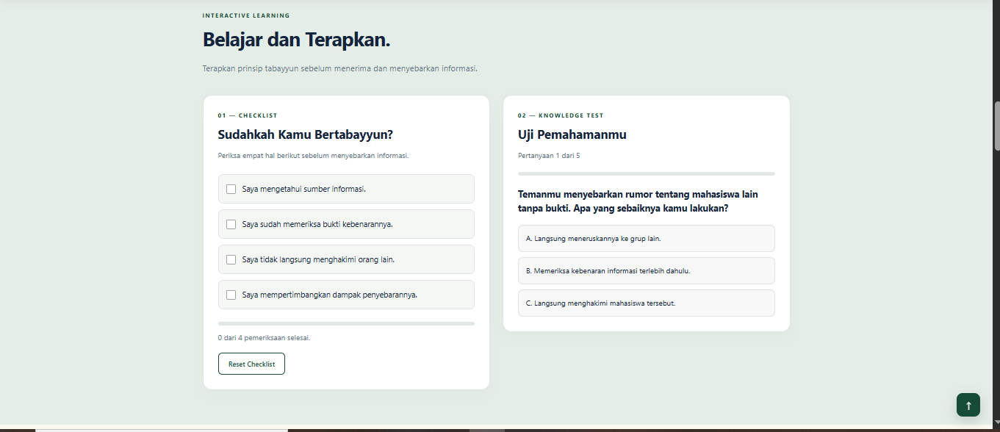
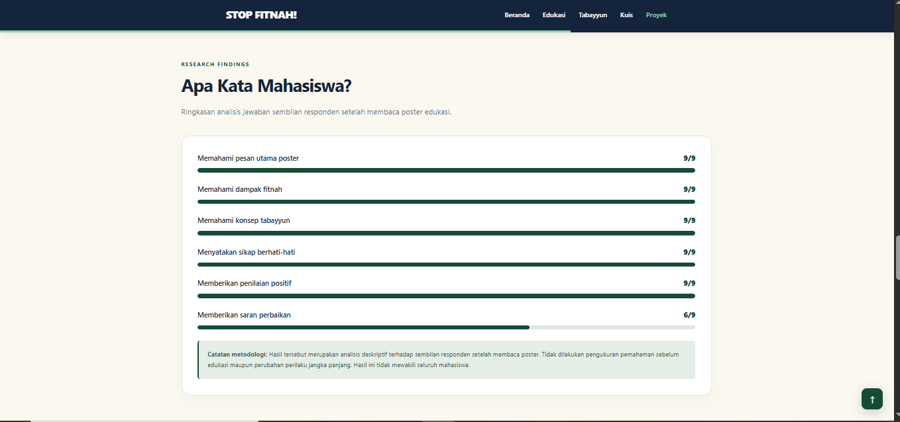
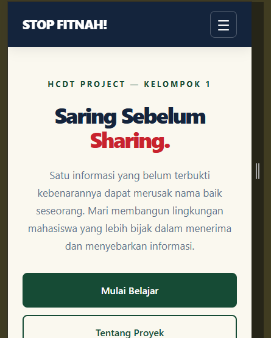

# Stop Fitnah! — Saring Sebelum Sharing

An interactive educational website promoting responsible information sharing, misinformation prevention, and the Islamic principle of Tabayyun among university students.


## Live Website

**Visit the website:**

https://nadhif-create.github.io/stop-fitnah-hcdt/

---

## Project Overview

Stop Fitnah is an educational project developed for an Islamic Religious Education course using the Human Centered Design Thinking (HCDT) approach.

The project addresses the spread of rumors, false accusations, and unverified information within university communities.

It originally started as a physical educational poster and was later developed into an interactive website.

## Project Objectives

- Raise awareness about the negative impacts of misinformation.
- Introduce the Islamic principle of Tabayyun.
- Encourage responsible information sharing.
- Provide practical and interactive educational resources.
- Document a user-centered product development process.

---

## Features

### Educational Features

- Educational content about the impacts of Fitnah.
- Four practical steps for preventing misinformation.
- Islamic perspective based on Quran 49:6.
- Interactive Tabayyun checklist.
- Dynamic checklist progress indicator.
- Interactive quiz with five questions.
- Automatic scoring and answer explanations.

### Research and Documentation

- Research findings dashboard.
- HCDT development timeline.
- User feedback documentation.
- Before-and-after prototype gallery.

### User Interface and Experience

- Responsive desktop and mobile interface.
- Poster lightbox.
- Mobile hamburger navigation.
- Active navigation indicator.
- Scroll reveal animations.
- Reading progress indicator.
- Back-to-top button.
- Custom website favicon.

---

## Technology Stack

| Technology | Purpose |
|------------|---------|
| HTML5 | Website structure and content |
| CSS3 | Styling and responsive layouts |
| JavaScript | Interactive features and application logic |
| GitHub | Source code management |
| GitHub Pages | Static website hosting |
| VS Code | Development environment |

No external framework, backend, or database is required.

---

## Human Centered Design Thinking

The project follows five main HCDT stages:

### 1. Empathize

Understand misinformation-related problems within university communities.

### 2. Define

Identify the need for accessible educational content about Fitnah and Tabayyun.

### 3. Ideate

Develop an educational campaign using visual media.

### 4. Prototype

Create the initial Stop Fitnah educational poster.

### 5. Test

Conduct poster testing and interviews with nine university students.

### Iteration and Digital Development

The initial poster was revised based on respondent feedback. The interactive website was subsequently developed as an additional educational resource.

---

## Research Findings

The poster testing was conducted on November 21, 2026.

| Indicator | Result |
|-----------|--------|
| Total respondents | 9 |
| Questions per respondent | 5 |
| Total interview responses | 45 |
| Respondents understanding the main message | 9/9 |
| Respondents understanding the impacts of Fitnah | 9/9 |
| Respondents understanding Tabayyun | 9/9 |
| Respondents expressing cautious attitudes | 9/9 |
| Positive responses | 9/9 |
| Respondents providing improvement suggestions | 6/9 |
| Poster versions | 2 |

The findings were obtained through descriptive qualitative analysis of anonymous interview responses.

### User Feedback

| Respondent | Improvement Suggestion |
|------------|------------------------|
| R1 | Improve text readability |
| R2 and R7 | Include Quranic excerpts or translations |
| R4 | Improve color contrast |
| R5 | Increase footer text size |
| R8 | Add more color variation to prevention icons |

The remaining three respondents provided positive feedback without suggesting specific changes.

---

## Prototype Evolution

### Version 1.0 — Initial Poster


The initial educational poster was used during the field-testing stage.

### Version 2.0 — Revised Poster



The revised poster incorporates feedback regarding readability, religious references, color contrast, typography, and visual design.

---


## Website Screenshots

### 1. Desktop Homepage



The main landing page introduces the Stop Fitnah campaign through its educational message, visual identity, and navigation.

### 2. Educational Section



This section explains the negative impacts of Fitnah and introduces practical steps for preventing misinformation.

### 3. Interactive Learning and Quiz



Users can practice the principle of Tabayyun through an interactive checklist and a five-question quiz with automatic scoring and answer explanations.

### 4. Research Dashboard



The research dashboard presents descriptive findings from anonymous interviews with nine university students during the initial poster-testing stage.

### 5. Mobile Interface



The responsive interface adapts to smaller screens and provides mobile-friendly navigation through a hamburger menu.

---

## Project Structure

    stop-fitnah-hcdt/
    |
    |-- index.html
    |-- style.css
    |-- script.js
    |-- README.md
    |
    |-- assets/
        |-- images/
            |-- sebelum_revisi.jpg
            |-- sesudah_revisi.jpg
            |
            |-- screenshots/
                |-- homepage.png
                |-- education.png
                |-- quiz.png
                |-- research.png
                |-- mobile.png

### File Responsibilities

| File or Directory | Description |
|-------------------|-------------|
| index.html | Main website structure and educational content |
| style.css | Visual styling, animations, and responsive design |
| script.js | Interactive features and application logic |
| README.md | Project documentation |
| assets/images/ | Educational poster assets |
| assets/screenshots/ | Website documentation screenshots |

---

## Running the Project Locally

1. Clone or download this repository.
2. Extract the project files if downloaded as a ZIP.
3. Open the project folder using Visual Studio Code.
4. Open index.html in a web browser.

Alternatively, use the Live Server extension in VS Code for automatic browser updates during development.

No additional dependencies or installation are required.

### Clone Repository

```bash
git clone https://github.com/nadhif-create/stop-fitnah-hcdt.git
```

---

## Development Experience

This project provided practical experience in:

- HTML document structure.
- CSS layout and responsive design.
- JavaScript DOM manipulation.
- Event handling and interactive features.
- Debugging and troubleshooting.
- File and asset management.
- GitHub repository management.
- Static website deployment.
- User-centered product development.
- Technical documentation.

AI-assisted development was used for code generation, technical guidance, and debugging.

---

## Development Workflow

    Project Planning
          |
          v
    HTML Development
          |
          v
    CSS Styling
          |
          v
    JavaScript Interaction
          |
          v
    HCDT Case Study Integration
          |
          v
    Testing and Debugging
          |
          v
    GitHub Pages Deployment
          |
          v
    Portfolio Documentation

---

## Research Limitations

- The poster testing involved only nine respondents.
- No pre-test measurement was conducted.
- Long-term behavioral changes were not measured.
- The revised poster has not undergone a second formal test.
- The interview results relate to the original poster, not the interactive website.
- Formal website usability testing has not yet been conducted.

The results should not be generalized to the entire university population.

---

## Future Improvements

- Conduct usability testing for the website.
- Collect additional anonymous user feedback.
- Expand the interactive quiz.
- Improve accessibility.
- Refine the educational content.
- Optimize performance across devices.
- Evaluate the effectiveness of the digital educational campaign.

---

## References

- The Quran, Surah Al-Hujurat, Verse 6.
- Indonesian Ministry of Religious Affairs: https://quran.kemenag.go.id/
- HCDT project documentation, Group 1.
- Anonymous student interviews, November 21, 2026.

---

## Project Credits

**Group 1 — Islamic Religious Education**

Human Centered Design Thinking Project, 2026.

---

## Project Status

- Educational poster: Completed
- Initial poster testing: Completed
- Poster revision: Completed
- Website development: Completed
- GitHub Pages deployment: Completed
- Formal website usability testing: Planned

---

## Closing Message

**Think before you share.**

Verify information, protect dignity, and build a more responsible digital community.

**Saring Sebelum Sharing!**
